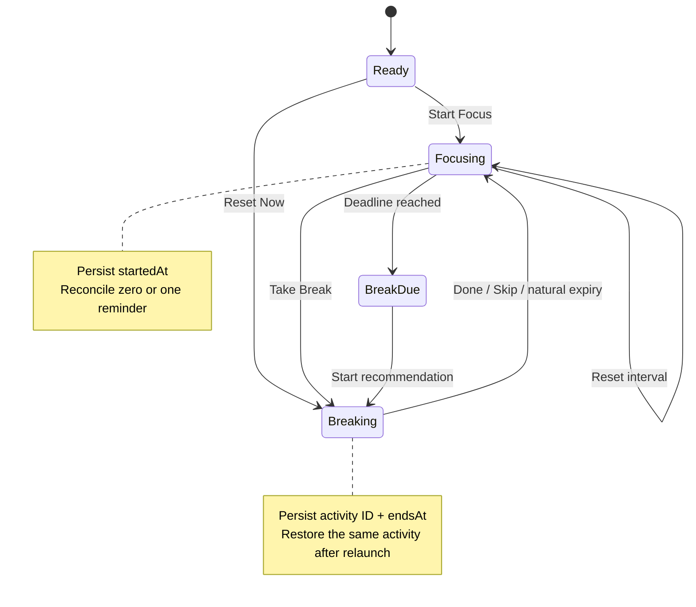

# Focusin: A Local-First macOS Micro-Break Companion

> Portfolio case study draft. The product and engineering claims below are implemented and locally verified; signed-candidate media, beta outcomes, and App Store availability remain pending.

## At A Glance

| | |
| --- | --- |
| Product | Native macOS 14+ menu bar utility |
| Core loop | Focus interval → break due → recommended reset → return to focus |
| Architecture | SwiftUI + AppKit, one `MainActor` store, local Codable persistence |
| Privacy | No account, backend, analytics, advertising, or network entitlement |
| Content | 21 reviewed activities in a validated bundled catalog |
| Verification | 54 deterministic tests plus native appearance/accessibility evidence |
| Release status | Unsigned local integrity passes; signing, beta, and distribution evidence remain open |

## The 30-Second Version

Break timers answer *when* to pause but still leave the user choosing *what* to do. Focusin keeps that decision in the menu bar: choose how you feel and how much time you have, receive one practical micro-break, complete or skip it, and return to focus.

The interesting engineering work is beneath the small interface. Wall-clock deadlines survive relaunch and sleep, a transparent recommendation policy separates hard preferences from soft matching, platform failures never block the local loop, and the entire version-one experience works without an account or network connection.

## Product Flow

1. Start or restore a focus interval.
2. Choose a current state and available break time.
3. Receive one recommendation from the local catalog.
4. At the deadline, enter break due with at most one optional notification.
5. Complete or skip the break; Focusin records same-day variety and begins focus again.

## The Problem

Desk workers can notice stiffness, fatigue, scattered attention, or anxiety without having the energy to choose a useful response. A generic reminder adds another decision at exactly the wrong moment. Focusin narrows the interaction to two inputs—state and time—and presents one optional, low-risk action without opening a productivity dashboard.

## Constraints That Shaped The Product

- Menu bar-first and immediately understandable.
- Native macOS controls rather than web-style interaction patterns.
- Useful when notifications, login-item permission, or platform services fail.
- Local-only version one: no account, sync, telemetry, advertising, or remote content.
- General-wellness language, never diagnosis or treatment.
- Persisted behavior must survive relaunch, sleep, clock changes, and old settings payloads.
- Recommendation content must be inspectable, testable, and attributable to a human review.

## Five Engineering Decisions

### 1. Persist deadlines, not countdown ticks

Focus states store `startedAt`; active breaks store an activity ID and `endsAt`. The one-second ticker updates presentation, but dates remain the source of truth. Relaunch, wake, and delayed timers therefore reconcile from elapsed wall time instead of accumulating drift.

### 2. Separate hard preferences from soft matching

Office-safe and mindfulness choices are never relaxed. State, duration, and same-day novelty are softened through a documented fallback order only when necessary. The engine can explain why an activity was eligible, avoid unnecessary empty states, and remain deterministic under test.

### 3. Keep content bundled and curated

A versioned JSON catalog is a deliberate product boundary, not missing AI. It keeps Focusin offline, makes safety language reviewable, preserves stable activity identities, and prevents unreviewed wellness instructions from appearing at runtime.

### 4. Reconcile platform services around a local core

`FocusinStore` owns the small state graph on `MainActor`. Notification and `SMAppService` adapters report their real status, while the focus/break loop continues independently. Activation, wake, clock, timezone, and day-change events all enter the same reconciliation path.

### 5. Treat accessibility as behavior

Primary actions have keyboard defaults, state never depends on color alone, large text expands native layouts, countdown duplicates are hidden from VoiceOver, progress semantics remain stable, and Settings actions expose named AX buttons. Accessibility defects are handled as workflow defects rather than presentation polish.

## Evidence, Not Claims

| Area | Recorded evidence |
| --- | --- |
| Domain behavior | 54 deterministic tests covering lifecycle, persistence, quiet hours, recommendation passes, catalog validation, permission reconciliation, and beta-template requirements |
| Catalog | 21 activities; every default-filter state/duration intersection covered; named human content review passed for 0.1.0 (1) |
| Native UI | Six popover presentations plus Settings captured across light/dark, normal/large text, increased contrast, and reduced transparency |
| Accessibility | Keyboard and VoiceOver semantics recorded; later AX inspection fixed unnamed Settings actions and per-second progress chatter |
| Privacy | App Sandbox only, no network entitlement, no tracking or collected-data declaration, local preferences/history |
| Distribution discipline | Unsigned Release preflight and archive tooling pass locally; signed archive and installed-candidate gates remain unexecuted |

Debug-fixture images in `docs/evidence` are engineering evidence, not App Store or final portfolio media.

## Scope Judgment

Version one intentionally excludes accounts, cloud sync, AI generation, social features, task management, streak pressure, and behavioral analytics. Those features would expand privacy, safety, moderation, operational, and support obligations without improving the core proof: a resilient native loop can remain small and useful.

## Honest Limitations

- No signed archive, TestFlight build, App Store listing, or installable beta exists yet.
- Signed notification, login-item, lifecycle, upgrade, and exact-candidate VoiceOver matrices remain open.
- The 5–8 person beta cohort has not run, so there are no usability or satisfaction metrics.
- The 21-item catalog is intentionally small; usefulness and variety still require real-world feedback.
- Final screenshots and the 30–45 second recording must come from the exact signed candidate.
- Focusin provides optional general-wellness prompts, not medical guidance.

## Five-To-Ten Minute Engineering Discussion

1. Why a menu bar utility fit the job better than a web or document app.
2. How date-derived state prevents relaunch and timer-drift bugs.
3. How hard constraints and ordered fallback passes make recommendations explainable.
4. Why a curated local catalog was safer and more private than remote generation.
5. How notification, login-item, and lifecycle events degrade without blocking the product.
6. Which risks still require signed-build and human evidence despite deterministic tests.

## Outcome Fields

Complete only from real evidence:

- Signed candidate version/build and commit:
- Beta cohort and tested macOS versions:
- Golden-path completion observations:
- Recommendation usefulness/variety findings:
- Lifecycle or accessibility defects found and fixed:
- TestFlight/App Store status:

## Portfolio Asset Set

Final assets are defined in [`CASE_STUDY_CAPTURE_MANIFEST.md`](CASE_STUDY_CAPTURE_MANIFEST.md). Until every asset references the same signed candidate, use the textual case study and clearly labeled engineering evidence only.
